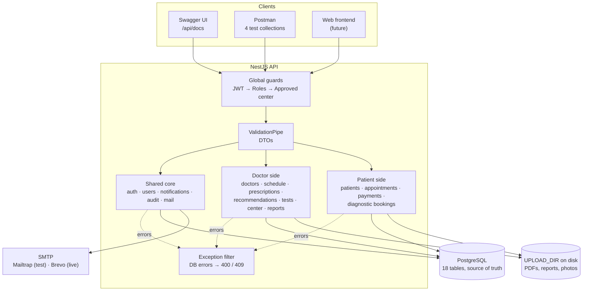
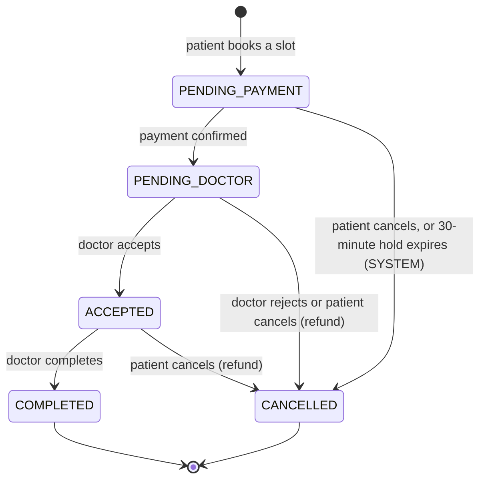
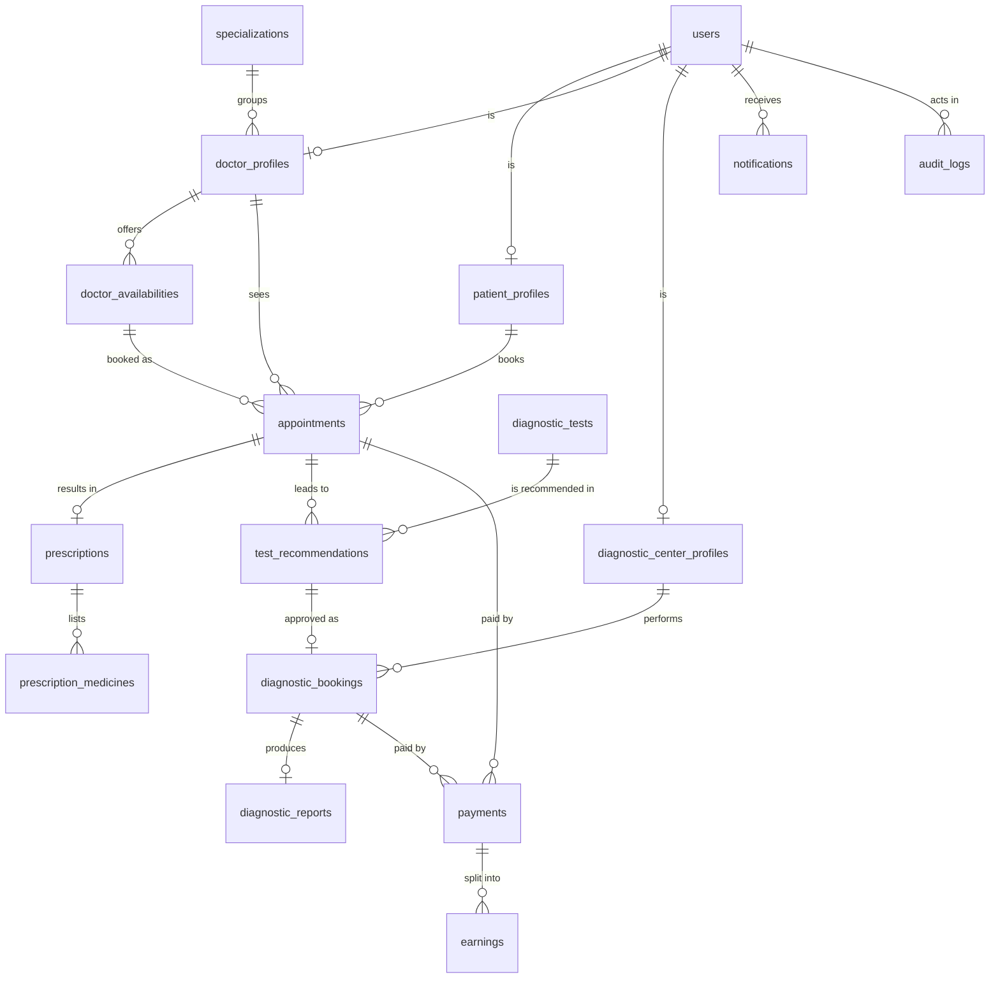
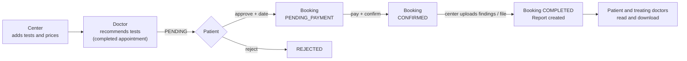

<div align="center">

# MediPulse

**Doctor appointments, prescriptions and diagnostic tests in one place**

Book a doctor, pay to confirm, get a digital prescription, and take the tests your doctor recommends, with the report waiting in your account.
Course project specification: *MediConnect BD*.

**Status:** Course release (backend v2) · **Last updated:** 18 Nov 2026 · **Origin:** CSC4161 Advanced Programming in Web Technology

</div>

---

This README describes the MediPulse backend as it is in this repository: a NestJS API with PostgreSQL, used through Swagger UI and Postman. There is no frontend in this repo yet. Section numbers are stable, so references such as §8 or FR-AP-3 can be used in the report.

**Run it:** [14. Getting Started](#14-getting-started) · **Where code goes:** [8. Repository Structure](#8-repository-structure) · **All endpoints:** [17. API Endpoints](#17-api-endpoints) · **What the course asks for:** [18. CSC4161 Course Release](#18-csc4161-course-release) · **Repository:** [asmaakther5058/MediPulse](https://github.com/asmaakther5058/MediPulse) · **Project board:** [Trello](TRELLO_LINK_HERE)

## Table of Contents

1. [Team](#1-team)
2. [Overview](#2-overview)
3. [Tech Stack](#3-tech-stack)
4. [Design Decisions](#4-design-decisions)
5. [Functional Requirements](#5-functional-requirements)
6. [Non-Functional Requirements](#6-non-functional-requirements)
7. [System Architecture](#7-system-architecture)
8. [Repository Structure](#8-repository-structure)
9. [Data Model](#9-data-model)
10. [Appointments and Booking](#10-appointments-and-booking)
11. [Diagnostic Tests and Reports](#11-diagnostic-tests-and-reports)
12. [Payments and Earnings](#12-payments-and-earnings)
13. [Security](#13-security)
14. [Getting Started](#14-getting-started)
15. [Development Workflow](#15-development-workflow)
16. [Testing](#16-testing)
17. [API Endpoints](#17-api-endpoints)
18. [CSC4161 Course Release](#18-csc4161-course-release)
19. [Future Work](#19-future-work)
20. [References](#20-references)

---

## 1. Team

**Group:** *TBD* · **Course:** CSC4161 Advanced Programming in Web Technology · **Semester:** Fall 2026

**Repository:** [github.com/asmaakther5058/MediPulse](https://github.com/asmaakther5058/MediPulse) · **Project board:** [Trello](TRELLO_LINK_HERE) · **Report:** `Final_MediPulse_Project_Report.docx`

| SL | Student ID | Name | Section | Contribution | Main tables |
|---|---|---|---|---|---|
| 1 | 23-53029-3 | Asma Akther | F | **Doctor module:** doctor profiles, specializations, doctor availability, appointment and consultation workflows | doctor_profiles, specializations, doctor_availabilities, appointments (doctor side), prescriptions, prescription_medicines, test_recommendations |
| 2 | 23-53666-3 | Sandipon Mondal | F | **Diagnostic Center module:** diagnostic center profiles, diagnostic tests, diagnostic bookings and diagnostic reports | diagnostic_center_profiles, diagnostic_tests, diagnostic_bookings, diagnostic_reports |
| 3 | 23-52626-2 | SK. Farhan Alvi | F | **Patient module and shared application work:** patient profile, appointment and medical record workflows | patient_profiles, appointments (patient side), patient access to prescriptions, recommendations, bookings and reports |
| 4 | 23-51643-2 | Chinmay Banik | F | **Admin module:** user administration, doctor verification, platform monitoring, payments and earnings oversight | users, payments, earnings, audit_logs, admin access across all modules |

**Shared by everyone** (merged into `main` first): auth (register, login, forgot and reset password, profile photo), notifications, mailer, password_reset_tokens, every entity and migration, and the common layer (guards, decorators, filters, validators). diagnostic_bookings and diagnostic_reports are shared by the Patient and Diagnostic Center workflows. Each member writes the DTOs, Swagger docs, tests and screenshots for their own endpoints.

The same table, with each member's AI-usage percentage, is on the cover of the project report.

## 2. Overview

Seeing a doctor usually means queuing at a chamber without knowing whether a slot is free, carrying a paper prescription that is easy to lose, and taking tests at a center whose report has to be collected in person. Bookings that are never paid for block slots that other patients needed.

### What MediPulse does differently

1. **Pay to confirm.** Booking a slot holds it for 30 minutes. If the patient does not pay in time, the slot is released automatically and someone else can take it.
2. **No double booking.** One slot on one date can have only one live booking. The database enforces it, so two patients who click at the same moment cannot both get it.
3. **Digital prescriptions.** The doctor writes the prescription in the app and a PDF is produced on save, with diagnosis, medicines, advice and follow-up date.
4. **Tests flow from the doctor to the lab.** The doctor recommends tests from the center's price list; the patient approves, picks a date and pays; the center performs the test and uploads the report.
5. **Reports stay private.** Only the patient, the doctors treating them and an admin can open a report or a patient's photo. Emails never contain medical results.
6. **Fair earnings.** Every paid consultation is split 50/50 between the doctor and the platform, and a refund removes both shares.
7. **Nothing changes silently.** Every create, update and delete is written to an audit log with who did it, what changed and from which IP address.

**Roles:** Patient · Doctor · Diagnostic center · Admin

## 3. Tech Stack

| Layer | Choice |
|---|---|
| Backend | NestJS 12 (TypeScript, ES modules): one modular app, split into a shared core, a doctor side and a patient side |
| Database | PostgreSQL 13 or newer (developed on 16); UUID keys from `gen_random_uuid()` |
| ORM and migrations | TypeORM 1.x: entities, transactions with row locks, hand-written migrations, `synchronize` off |
| Auth | `@nestjs/jwt` with `passport-jwt`; bcrypt with 12 rounds; global JWT and role guards |
| Validation | class-validator and class-transformer DTOs behind a global ValidationPipe (`whitelist`, `forbidNonWhitelisted`, `transform`) |
| Config | `@nestjs/config`, validated at start-up by a class-validator schema |
| API docs | `@nestjs/swagger` at `/api/docs`, with the Swagger CLI plugin reading DTOs and comments |
| Email | `@nestjs-modules/mailer` with Nodemailer and Handlebars templates; Mailtrap sandbox for testing, any SMTP (for example Brevo) for real delivery |
| Files | Multer uploads kept on disk under `UPLOAD_DIR`; PDFKit for prescription PDFs |
| Tooling | npm, Prettier, oxlint, Vitest, Postman collections run with Newman |

## 4. Design Decisions

| ID | Decision | Key reason |
|---|---|---|
| DD-01 | One NestJS app with a shared core, a doctor side and a patient side | Team members can work in parallel; the sides never edit the same file, so pull requests merge cleanly |
| DD-02 | UUID primary keys everywhere | Ids cannot be guessed or counted |
| DD-03 | Hand-written migrations, one file per table; `synchronize` off | The schema is reviewable and repeatable; a migration that has run is never edited |
| DD-04 | A booking holds the slot for 30 minutes until it is paid; expired holds are cancelled before any read or write that depends on them | No background job is needed and unpaid bookings never block a slot for long |
| DD-05 | A partial unique index allows one live booking per slot per date | The database refuses a double booking even if two requests arrive at once |
| DD-06 | Row locks (`SELECT … FOR UPDATE`) on the appointment, payment and booking rows before a state change | Accept, reject, pay and cancel cannot interleave |
| DD-07 | A rejected appointment becomes `CANCELLED` with `cancelled_by = DOCTOR` (no separate REJECTED status) | One cancelled tab for the patient; the reason is still recorded (spec decision) |
| DD-08 | The diagnosis is written inside the prescription | One step for the doctor; the medical history lists diagnoses separately (spec decision) |
| DD-09 | One diagnostic center in this version. At most one center can be PENDING or APPROVED, enforced by a partial unique index; a REJECTED one does not count | Matches the spec, and a new center can apply after a rejection |
| DD-10 | Doctors and centers sign themselves up but stay PENDING until an admin approves them; a pending center can only see and edit its own profile | Nobody unverified treats patients or handles their samples |
| DD-11 | Payments are simulated: create, then confirm | The course does not need a real gateway; the flow and the database writes are the real ones |
| DD-12 | Two earnings rows (50% doctor, 50% platform) are written in the same transaction as the payment confirmation | Revenue reports read real rows and always add up |
| DD-13 | Files are stored on disk with random names and served only through endpoints that check access; the file type is detected from its first bytes | No guessable public URLs; a renamed file is rejected |
| DD-14 | Emails are sent after the database change commits and never fail the request | A mail outage cannot break booking or registration |
| DD-15 | One global interceptor writes the audit log | Every module is covered without extra code, and passwords and tokens are stripped |
| DD-16 | Dates are plain `YYYY-MM-DD` values in the Asia/Dhaka calendar; timestamps are stored as `timestamptz` | Slots and appointment dates mean the same thing on every computer |
| DD-17 | One global exception filter maps database errors: unique and foreign key to 409, check constraint and bad values to 400, everything else to a generic 500 | Predictable error codes and no stack traces in responses |

## 5. Functional Requirements

**Accounts**

- **FR-AC-1:** Patients register with name, email, password and optional phone, date of birth, gender and address; a patient profile with a unique patient code (`PAT-XXXXXXXX`) is created in the same transaction.
- **FR-AC-2:** Doctors register themselves with specialization, qualifications, experience and fee; they stay PENDING until an admin approves them.
- **FR-AC-3:** A diagnostic center registers itself (account and center profile together) and stays PENDING until an admin approves it.
- **FR-AC-4:** Everyone logs in with email and password and receives a JWT. Admins can create accounts for any role.
- **FR-AC-5:** Users edit their profile, change their password, upload a profile photo and reset a forgotten password through a one-time emailed link.

**Doctors and schedules**

- **FR-DR-1:** Approved doctors add weekly time blocks between 10:00 and 22:00; each block is split into 20-minute slots.
- **FR-DR-2:** Anyone can browse approved doctors, filter by specialization and see free slots on a date.
- **FR-DR-3:** Doctors see a dashboard (appointment counts, patients consulted, earnings, new requests) and a list of their own patients.

**Appointments**

- **FR-AP-1:** A patient books a free slot; the booking is held for 30 minutes for payment.
- **FR-AP-2:** After payment the doctor accepts or rejects the request; a rejection refunds the payment.
- **FR-AP-3:** The doctor marks an accepted appointment completed.
- **FR-AP-4:** Patients cancel their own appointments; a paid one is refunded.
- **FR-AP-5:** Lists are grouped into upcoming (soonest first), completed and cancelled tabs.

**Prescriptions**

- **FR-RX-1:** For a completed appointment the doctor writes one prescription with diagnosis, advice, follow-up date and medicines.
- **FR-RX-2:** A PDF is produced on save and rebuilt on every edit; the patient downloads it.

**Diagnostic tests**

- **FR-DT-1:** The center (or an admin) manages the test list with prices.
- **FR-DT-2:** For a completed appointment the doctor recommends one or more tests; if any test id is wrong, nothing is saved.
- **FR-DT-3:** The patient approves (with a date) or rejects a recommendation; approval creates a booking at the test's price.
- **FR-DT-4:** After payment the center performs the test and records findings, a file (PDF, PNG or JPG) or both.
- **FR-DT-5:** Patients, their treating doctors and admins read and download reports.

**Patients**

- **FR-PT-1:** A patient dashboard shows appointment counts, the next appointment, pending recommendations, completed tests and recent notifications.
- **FR-PT-2:** The medical history lists appointments, diagnoses, prescriptions, test bookings and reports, for the patient, their treating doctors and admins.

**Notifications, email and audit**

- **FR-NT-1:** In-app notifications for approvals, bookings, payments, prescriptions, recommendations and reports, with an unread count.
- **FR-NT-2:** Emails for welcome, appointment receipt, test receipt, report ready, password reset and password changed.
- **FR-AD-1:** Admins see a platform dashboard, revenue and the audit log, and manage users, specializations, doctors, the center and payments.

## 6. Non-Functional Requirements

| ID | Category | Target |
|---|---|---|
| NFR-01 | Concurrency | Zero double bookings. Test: parallel bookings for the same slot produce exactly one winner; two center sign-ups at once produce one 201 and one 409 |
| NFR-02 | Consistency | A payment, its booking status change and its earnings rows commit together or not at all; a refund removes the earnings |
| NFR-03 | Security | bcrypt (12 rounds); hashes, tokens and file paths never appear in responses or the audit log; tokens issued before a password change stop working |
| NFR-04 | Privacy | Reports, prescriptions, patient photos and medical history are visible only to the patient, their treating doctors and admins; others get 404 or 403 |
| NFR-05 | Input and errors | Every body and query is a DTO; unknown fields are rejected; a 400 names each failing field; responses never contain stack traces |
| NFR-06 | Paging | Every list over a growing table is paged (`page`, `limit`, at most 50) and returns a `pagination` block |
| NFR-07 | Configuration | The app refuses to start when a required setting is missing or invalid, listing every problem |
| NFR-08 | Files | Reports up to 5 MB, photos up to 2 MB; the type is checked from the file's bytes |
| NFR-09 | Correctness | Money as `numeric(10,2)`; dates as `YYYY-MM-DD` in Asia/Dhaka; timestamps in UTC (`timestamptz`) |
| NFR-10 | Maintainability | The schema changes only through migrations; the Postman suites must pass before a merge |

## 7. System Architecture

One NestJS API owns every rule. Clients (Swagger UI and Postman today, a web frontend later) only call REST endpoints.



### Modules

| Module | Owns (tables) | Responsibility | Side |
|---|---|---|---|
| auth | password_reset_tokens | Register, login, profile, change and reset password, JWT strategy | Shared |
| users | users | Admin user management, profile photos | Shared |
| specializations | specializations | List and manage specializations | Shared |
| notifications | notifications | In-app notifications, unread count | Shared |
| audit-logs | audit_logs | Global audit interceptor, admin reads | Shared |
| admin | — | Platform dashboard | Shared |
| mail | — | Email templates and sending | Shared |
| earnings | earnings | Entity only; written by payments, read by revenue reports | Shared |
| doctors | doctor_profiles | Doctor sign-up, verification, dashboard, my patients | Doctor |
| doctor-availability | doctor_availabilities | Weekly schedule split into 20-minute slots | Doctor |
| doctor-appointments | — (appointments) | Accept, reject and complete | Doctor |
| prescriptions | prescriptions, prescription_medicines | Prescriptions and their PDFs | Doctor |
| test-recommendations | test_recommendations | Doctor recommends tests | Doctor |
| diagnostic-tests | diagnostic_tests | Test list with prices | Doctor |
| diagnostic-centers | diagnostic_center_profiles | Center sign-up, approval, dashboard | Doctor |
| diagnostic-reports | diagnostic_reports | Complete a booking with findings or a file; report reads and downloads | Doctor |
| payment-reports | — (payments, earnings) | Doctor and admin revenue | Doctor |
| patients | patient_profiles | Profile, dashboard, medical history | Patient |
| appointments | appointments | Free slots, booking, cancel, tabs | Patient |
| payments | payments | Pay and confirm, for appointments and tests | Patient |
| diagnostic-bookings | diagnostic_bookings | Approve or reject recommendations, bookings, cancel | Patient |

### Boundary rules

1. Every entity, migration and the common layer live in the shared core, so both sides compile on their own.
2. A side registers its modules only in its own file: `doctor-features.module.ts` or `patient-features.module.ts`. Neither side edits `app.module.ts`.
3. State changes that touch several tables run in one transaction with the rows locked first.
4. Only the payments module writes `payments` and `earnings`; revenue reports only read them.
5. Email and file work never decide whether a request succeeds.

### Appointment state machine



`cancelled_by` records who cancelled: `PATIENT`, `DOCTOR` or `SYSTEM`. Any other transition returns 400 or 409.

### API conventions

- **Base path.** Endpoints sit at the root (`http://localhost:3000/auth/login`); Swagger is at `/api/docs`.
- **Auth.** Every route needs `Authorization: Bearer <token>` unless it is marked `@Public()`. `@Roles()` limits a route to roles; `@OptionalAuth()` serves anonymous callers but recognises a token when one is sent.
- **Validation.** Every body and query is a DTO; unknown fields are rejected and a 400 lists each failing field. Dates are `YYYY-MM-DD` and must be real calendar dates.
- **Errors.** `{ "statusCode", "error", "message" }`. PostgreSQL 23505 and 23503 become 409; 23514, 22P02, 22007, 22008, 22001 and 22003 become 400; anything else is a 500 with a generic message.
- **Paging.** Lists take `page` (from 1) and `limit` (1 to 50, default 10) and return `{ data, pagination: { total, page, limit, totalPages, hasNextPage, hasPreviousPage } }`.
- **Responses.** Password hashes and stored file paths are never returned; files are reached through links such as `/prescriptions/{id}/pdf` or `/users/{id}/photo`.

## 8. Repository Structure

```text
MediPulse/
├── README.md                         this file
└── backend/                          NestJS API
    ├── src/
    │   ├── main.ts                   bootstrap: CORS, ValidationPipe, exception filter, Swagger
    │   ├── app.module.ts             config (validated), TypeORM, shared modules
    │   ├── doctor-features.module.ts doctor side registers its modules here
    │   ├── patient-features.module.ts patient side registers its modules here
    │   ├── common/
    │   │   ├── decorators/           @Public(), @Roles(), @CurrentUser(), @OptionalAuth()
    │   │   ├── dto/                  pagination and appointment queries
    │   │   ├── enums/                roles and every status
    │   │   ├── filters/              database exception filter
    │   │   ├── guards/               JwtAuthGuard, RolesGuard, ApprovedCenterGuard
    │   │   ├── interfaces/           AuthUser, JwtPayload
    │   │   ├── utils/                dates, codes, locks, refunds, earnings, storage, safe users
    │   │   └── validators/           @IsValidDate()
    │   ├── config/                   database config, env validation
    │   ├── database/
    │   │   ├── data-source.ts        TypeORM CLI data source (explicit migration list)
    │   │   ├── run-migrations.ts
    │   │   ├── migrations/           21 hand-written migrations, one per table or change
    │   │   └── seeds/                seed-admin.ts, seed-demo.ts
    │   └── modules/                  one folder per module (§7), each with entities/, dto/,
    │                                 controller, service and module files
    ├── .env.example                  copy to .env
    ├── nest-cli.json                 Swagger plugin, copies email templates into dist/
    └── package.json                  npm scripts
```

**Who builds what**

| Folder in `backend/src/` | Built by |
|---|---|
| `common/`, `config/`, `database/`, every `entities/` folder, `modules/auth`, `notifications`, `mail` | Shared (merged to `main` first) |
| `modules/doctors`, `specializations`, `doctor-availability`, `doctor-appointments`, `prescriptions`, `test-recommendations` | Asma Akther (Doctor module) |
| `modules/diagnostic-centers`, `diagnostic-tests`, `diagnostic-bookings`, `diagnostic-reports` | Sandipon Mondal (Diagnostic Center module) |
| `modules/patients`, `appointments`, `payments` (patient payments) | SK. Farhan Alvi (Patient module) |
| `modules/users`, `admin`, `audit-logs`, `earnings`, `payment-reports` | Chinmay Banik (Admin module) |

The code is still wired as a doctor side (`doctor-features.module.ts`) and a patient side (`patient-features.module.ts`), as described in §7; the table above shows which member owns each module within them.

Uploaded files go to `backend/uploads/` (or `UPLOAD_DIR`), which Git ignores, as it does `.env`.

## 9. Data Model

18 tables, all with UUID keys and `created_at` / `updated_at` timestamps.

| Table | Main fields | Relationships |
|---|---|---|
| users | full_name, email (unique), phone (unique), password_hash, role, profile_image_url, is_active, password_changed_at | 1:1 patient_profiles, doctor_profiles, diagnostic_center_profiles |
| specializations | name (unique), description, is_active | 1:N doctor_profiles |
| patient_profiles | user_id, patient_code (unique), date_of_birth, gender, blood_group, address, emergency_contact | 1:N appointments, prescriptions, test_recommendations, diagnostic_bookings |
| doctor_profiles | user_id, specialization_id, qualifications, experience_years, consultation_fee, professional_info, verification_status | 1:N doctor_availabilities, appointments, prescriptions, test_recommendations |
| doctor_availabilities | doctor_id, day_of_week, start_time, end_time (20 min, 10:00–22:00), is_available | 1:N appointments |
| appointments | patient_id, doctor_id, availability_id, appointment_date, start_time, end_time, consultation_fee, status, hold_expires_at, cancelled_by, rejection_reason, cancellation_reason | 1:N payments; 1:1 prescriptions |
| prescriptions | appointment_id (unique), diagnosis, advice, follow_up_date, pdf_path | 1:N prescription_medicines |
| prescription_medicines | prescription_id, medicine_name, dosage, frequency, duration, instructions | N:1 prescriptions |
| diagnostic_tests | test_name (unique), category, price, sample_type, preparation_instructions, is_active | 1:N test_recommendations |
| test_recommendations | appointment_id, doctor_id, patient_id, diagnostic_test_id, recommendation_note, status, responded_at, rejection_reason | 1:1 diagnostic_bookings |
| diagnostic_center_profiles | user_id, center_name, license_number (unique), address, city, area, contact_number, description, verification_status | 1:N diagnostic_bookings |
| diagnostic_bookings | recommendation_id, patient_id, diagnostic_center_id, booking_date, booking_time, price, status, completed_at | 1:N payments; 1:1 diagnostic_reports |
| diagnostic_reports | booking_id (unique), uploaded_by_user_id, findings, file_path, file_name, mime_type, file_size | N:1 users (uploader) |
| payments | payment_type, appointment_id or diagnostic_booking_id (exactly one), amount, currency, payment_method, status, transaction_id, paid_at | 1:N earnings |
| earnings | payment_id, beneficiary_user_id, beneficiary_role (DOCTOR or ADMIN), amount, share_percentage | N:1 payments, users |
| notifications | recipient_user_id, notification_type, title, message, is_read, related_entity_type, related_entity_id | N:1 users |
| audit_logs | actor_user_id, action, entity_name, entity_id, old_values, new_values (JSONB), ip_address | N:1 users |
| password_reset_tokens | user_id, token_hash (unique), expires_at, used_at | N:1 users |



**Database rules that protect the data:** one live booking per slot and date (partial unique index); one PENDING or PAID payment per appointment and per booking (partial unique indexes); a payment points to exactly one target (check constraint); the same test only once per appointment, and one active booking per recommendation (unique indexes); one PENDING or APPROVED diagnostic center (partial unique index); slot times on the 20-minute grid between 10:00 and 22:00 (check constraint).

## 10. Appointments and Booking

1. `GET /doctors/{doctorId}/slots?date=YYYY-MM-DD` lists the doctor's slots on that weekday with `isAvailable`.
2. `POST /appointments` locks the slot, checks it is free, and creates the appointment as `PENDING_PAYMENT` with `hold_expires_at` 30 minutes ahead.
3. `POST /payments`, then `POST /payments/{id}/confirm`, moves it to `PENDING_DOCTOR`, writes the earnings rows and emails the receipt.
4. The doctor accepts (`ACCEPTED`) or rejects (`CANCELLED` by `DOCTOR`, with a refund), and later completes it (`COMPLETED`).
5. Holds that pass `hold_expires_at` unpaid become `CANCELLED` by `SYSTEM` the next time any list, slot or payment is read, so the slot frees itself.

## 11. Diagnostic Tests and Reports



- **The doctor never creates tests**; they choose from the center's list. **The center never decides** what a patient needs; it performs approved, paid bookings.
- A recommendation with several tests is all or nothing: one unknown test id returns 404 and saves nothing.
- Bookings always go to the one approved center. A center that is not approved receives no bookings and gets 403 on everything except its own profile.
- Reports accept findings, a file (PDF, PNG or JPG up to 5 MB) or both; the center can correct them later.

## 12. Payments and Earnings

- **Two kinds of payment:** `CONSULTATION` (an appointment) and `DIAGNOSTIC_TEST` (a booking). Methods: `CARD`, `MOBILE_BANKING`, `BANK_TRANSFER`. Payment is simulated: create it, then confirm it.
- **Earnings:** confirming a consultation payment writes two rows in the same transaction, 50% to the doctor and 50% to the platform admin.
- **Refunds:** a doctor's rejection or a patient's cancellation marks paid payments `REFUNDED` and deletes their earnings rows; an admin can also mark a payment `FAILED` or `REFUNDED`.
- **Reports:** doctors see their payments, earnings rows and revenue (`/payments/revenue/doctor/my`); admins see all payments and platform revenue.

## 13. Security

- **Passwords:** bcrypt with 12 rounds; the hash is never returned or logged.
- **Tokens:** JWT signed with `JWT_SECRET`, valid for `JWT_EXPIRES_IN` seconds. The user is re-read on every request, so deactivation and role changes apply at once, and tokens issued before a password change or reset are rejected.
- **Password reset:** a random 64-character token valid for 30 minutes and usable once; only its SHA-256 hash is stored; the answer is the same whether or not the email exists; at most 3 requests per account per 15 minutes.
- **Authorization:** global JWT, role and approved-center guards, plus ownership checks in the services (own appointments, own patients, own reports).
- **Input:** DTOs on every request, real-date validation, file types detected from their bytes, size limits on uploads.
- **Configuration:** `.env` is never committed; the app refuses to start on missing or invalid settings and rejects a weak `JWT_SECRET` in production.
- **Audit:** every create, update and delete is logged with actor, IP address and the changed fields; passwords, tokens and file paths are stripped.

## 14. Getting Started

### Prerequisites

Node.js 20.19+, 22.13+ or 24.11+ (needed by TypeORM 1.x) · npm · PostgreSQL 13 or newer (16 recommended) · Git

### Local setup

```powershell
git clone https://github.com/asmaakther5058/MediPulse.git
cd MediPulse/backend
npm install
copy .env.example .env          # macOS/Linux: cp .env.example .env
# edit .env: DB_PASSWORD, JWT_SECRET and the SEED_* passwords
```

Create an empty database named as in `DB_DATABASE` (default `medipulse_db`) in pgAdmin or with `createdb medipulse_db`, then:

```powershell
npm run migration:run           # 21 migrations, 18 tables
npm run seed:admin              # first admin, from SEED_ADMIN_* in .env
npm run seed:demo               # optional: demo doctors, patients, center and tests
npm run start:dev               # API on http://localhost:3000
```

Run `npm` commands inside `backend/`, and run `npm run migration:run` again after every pull that adds a migration.

| What | Where |
|---|---|
| API | http://localhost:3000 |
| Swagger UI | http://localhost:3000/api/docs: log in, click **Authorize**, paste the `accessToken` |
| Uploaded files | `backend/uploads/` (or `UPLOAD_DIR`) |
| Emails | Your Mailtrap inbox, the real inbox (Brevo), or the server log when `MAIL_HOST` is empty |

### Demo accounts

`seed:admin` creates the admin; `seed:demo` creates the rest. Every demo account uses the password in `SEED_DEMO_PASSWORD`. The seeds skip anything that already exists, so they are safe to run twice.

| Role | Name | Email | Notes |
|---|---|---|---|
| Admin | System Admin | value of `SEED_ADMIN_EMAIL` (default `admin@medipulse.local`) | Password from `SEED_ADMIN_PASSWORD` |
| Doctor | Dr. Farhana Rahman | farhana@demo.medipulse | Cardiology, fee 1000 BDT, approved |
| Doctor | Dr. Tanvir Hasan | tanvir@demo.medipulse | General Medicine, fee 700 BDT, approved |
| Patient | Ayesha Khan | ayesha@demo.medipulse | |
| Patient | Karim Uddin | karim@demo.medipulse | |
| Diagnostic center | MediPulse Diagnostic Centre | lab@demo.medipulse | Approved; licence DGHS-DEMO-0001 |

Both doctors work Sunday to Thursday and Saturday, 10:00–13:00 (nine 20-minute slots a day). The demo also adds 5 specializations and 9 priced tests, from Blood Glucose (200 BDT) to Lipid Profile (1200 BDT).

**Demo flows to try**

| Demo | Try this |
|---|---|
| Book and pay | As Ayesha: free slots for Dr. Tanvir on the next Sunday, book one, pay and confirm. As Tanvir: the dashboard shows a new request; accept it |
| Double booking | Two patients book the same slot; the second gets 409 |
| Expired hold | Book without paying; after 30 minutes the appointment shows in the cancelled tab, cancelled by `SYSTEM` |
| Prescription | Complete the appointment as the doctor, write a prescription, download the PDF as the patient |
| Rollback | Recommend two tests where one id is `00000000-0000-0000-0000-000000000000`: 404 and nothing saved |
| Test to report | Patient approves the recommendation and pays; the center completes the booking with a PDF; the patient downloads it |
| Center approval | As admin, reject the demo center; register a new center (`POST /diagnostic-centers/register`): it gets 403 until the admin approves it |
| Forgot password | Leave `MAIL_HOST` empty, call `POST /auth/forgot-password`, and copy the reset link from the server log |

### Environment variables

Checked at start-up; the app refuses to start and lists every problem when a required value is missing or invalid.

| Variable | Purpose | Required |
|---|---|---|
| `NODE_ENV` | `development`, `production` or `test` | No (development) |
| `PORT` | API port | No (3000) |
| `CORS_ORIGINS` | Comma-separated frontend origins | No (all, in development) |
| `DB_HOST`, `DB_PORT`, `DB_USERNAME`, `DB_PASSWORD`, `DB_DATABASE` | PostgreSQL connection | Yes (port defaults to 5432) |
| `DB_LOGGING` | `true` prints SQL | No |
| `JWT_SECRET` | Token signing key; at least 32 random characters in production | Yes |
| `JWT_EXPIRES_IN` | Token lifetime in seconds | No (3600) |
| `UPLOAD_DIR` | Folder for PDFs, reports and photos | No (`uploads`) |
| `MAIL_HOST`, `MAIL_PORT`, `MAIL_USER`, `MAIL_PASSWORD`, `MAIL_FROM` | SMTP; empty `MAIL_HOST` prints emails to the log instead | No |
| `FRONTEND_URL` | Base of the link in password-reset emails | No (`http://localhost:5173`) |
| `SEED_ADMIN_EMAIL`, `SEED_ADMIN_PASSWORD`, `SEED_ADMIN_NAME` | Used by `seed:admin` only | For the seed |
| `SEED_DEMO_PASSWORD` | Used by `seed:demo` only | For the seed |

**Email setup.** For testing, use a Mailtrap **Email Testing (Sandbox)** inbox: host `sandbox.smtp.mailtrap.io`, port 2525, and its username and password; emails are caught there and never reach real inboxes. For real delivery without a domain, use Brevo (`smtp-relay.brevo.com`, port 587, the SMTP login and key, and a verified sender in `MAIL_FROM`) or Gmail with an App Password. If sending fails with *self-signed certificate in certificate chain*, antivirus email scanning or the network is intercepting the connection: turn off outbound email scanning or try another network.

### Scripts

Run inside `backend/`:

| Command | Does |
|---|---|
| `npm run start:dev` | Run the API and restart on changes |
| `npm run build`, then `npm run start:prod` | Compile to `dist/` and run it |
| `npm run migration:run` | Apply pending migrations |
| `npm run migration:show` | List migrations and whether each has run |
| `npm run migration:revert` | Undo the last migration |
| `npm run migration:generate -- src/database/migrations/<Name>` | Draft a migration from entity changes (then rewrite it in the per-table style) |
| `npm run seed:admin` / `npm run seed:demo` | Create the admin / the demo data |
| `npm run lint` | oxlint on `src/` and `test/` |
| `npm run format` | Prettier on `src/` and `test/` |
| `npm test`, `npm run test:e2e` | Vitest unit and end-to-end tests |

### Troubleshooting

| Problem | Fix |
|---|---|
| `Could not read package.json` | Run `npm` inside `backend/` |
| `EADDRINUSE :::3000` | Another server is running; stop it, or set `PORT=3001` |
| `column ... does not exist` | The database is behind the code: run `npm run migration:run` (or start from an empty database) |
| `Invalid .env configuration` | Fix the settings it lists, then restart |
| `ERESOLVE` on `npm install` | A package outside `package.json` was installed by hand; remove it (`npm uninstall <name> --legacy-peer-deps`) |
| 401 in Swagger | Log in again and **Authorize** with the new token (tokens expire, and a password change logs you out) |
| 403 *not approved yet* | An admin must approve the doctor or the center first |

## 15. Development Workflow

- **Branches.** Each member works on their own branch (for example `Asma-Akther--Doctor-Branch`, `Farhan-Alvi-Patient-Branch`) or a short feature branch, always started from an up-to-date `main`. Changes reach `main` only through a pull request.
- **Order.** Shared changes (entities, migrations, common code) merge first; then each side pulls `main` before continuing.
- **Migrations.** Never edit a migration that has run anywhere; add a new file named `YYYYMMDDHHMMSS-Description.ts` and list it in `src/database/data-source.ts`. `synchronize` stays off.
- **Secrets.** Never commit `.env` or `uploads/`. Share SMTP keys and passwords privately.
- **Definition of done:**
  - The four Postman suites pass and the server log shows no 500.
  - New endpoints have DTOs, Swagger docs and role checks.
  - Schema changes have a migration, and `migration:generate` reports no differences afterwards.
  - Screenshots for the report are taken (success, 400, 401, 403, 404 and 409 where they apply).

## 16. Testing

| Level | What | Result |
|---|---|---|
| API suites | Four Postman collections (Patient, Doctor, DiagnosticCenter, Admin) covering every role's flow and error cases, run with Newman | 397 assertions, 0 failures |
| Concurrency | 10 patients book the same slot at once | Exactly 1 booking, 9 × 409 |
| Concurrency | The same password-reset link used twice at once; two center sign-ups at once | One success each, the other refused |
| Rollback | A recommendation with one unknown test id | 404, nothing saved |
| Files | Fake PDF, oversized file, real PDF upload and byte-identical download, another patient's report | 400, 413, 201 + identical bytes, 404 |
| Schema | Fresh database: run all migrations, compare with the entities, revert and re-run | No differences |

Run the Postman suites after `seed:demo`, with the admin and center credentials set in the collection variables.

## 17. API Endpoints

118 endpoints, grouped by the side that owns them. *Public\** means anyone may call it, but a token is used when sent (patient photos need one). "Any role" means any logged-in user. Every list endpoint is paged.

**Shared** (29 endpoints)

| Module | Method | Endpoint | Purpose | Access |
|---|---|---|---|---|
| App | GET | `/` | Health check | Public |
| Auth and account | POST | `/auth/register` | Patient sign-up (creates user + patient profile) | Public |
| Auth and account | POST | `/auth/login` | Log in; returns accessToken | Public |
| Auth and account | POST | `/auth/forgot-password` | Email a one-time reset link (30 min) | Public |
| Auth and account | POST | `/auth/reset-password` | Set a new password with the emailed code | Public |
| Auth and account | GET | `/auth/profile` | Who am I (role, name, email) | Any role |
| Auth and account | PATCH | `/auth/profile` | Change own name, email, phone | Any role |
| Auth and account | PATCH | `/auth/change-password` | Change password; logs out old sessions | Any role |
| Users and photos | POST | `/users/admin-create` | Create a DOCTOR, CENTER or ADMIN account | Admin |
| Users and photos | GET | `/users` | All users (filter by role, search, active) | Admin |
| Users and photos | GET | `/users/:id` | One user | Admin |
| Users and photos | PATCH | `/users/:id` | Edit a user / activate / deactivate | Admin |
| Users and photos | DELETE | `/users/:id` | Delete a user | Admin |
| Users and photos | PATCH | `/users/:id/role` | Change a user's role | Admin |
| Users and photos | POST | `/auth/profile/photo` | Upload or replace own photo (PNG, JPG, WebP, 2 MB) | Any role |
| Users and photos | DELETE | `/auth/profile/photo` | Remove own photo | Any role |
| Users and photos | GET | `/users/:id/photo` | The photo (doctor and center photos public; patient photos private) | Public* |
| Specializations | POST | `/specializations` | Add a specialization | Admin |
| Specializations | GET | `/specializations` | List specializations | Public |
| Specializations | GET | `/specializations/:id` | One specialization | Public |
| Specializations | PATCH | `/specializations/:id` | Edit a specialization | Admin |
| Specializations | DELETE | `/specializations/:id` | Delete a specialization | Admin |
| Notifications | GET | `/notifications/my` | My notifications (newest first) | Any role |
| Notifications | GET | `/notifications/my/unread-count` | Number for the bell | Any role |
| Notifications | PATCH | `/notifications/read-all` | Mark all read | Any role |
| Notifications | PATCH | `/notifications/:id/read` | Mark one read | Any role |
| Audit log | GET | `/audit-logs` | Who changed what, when (filters) | Admin |
| Audit log | GET | `/audit-logs/:id` | One audit entry with old/new values | Admin |
| Admin dashboard | GET | `/admin/dashboard` | Platform totals, revenue split, recent activity | Admin |

**Doctor side** (62 endpoints)

| Module | Method | Endpoint | Purpose | Access |
|---|---|---|---|---|
| Doctors | POST | `/doctors/register` | Doctor sign-up (PENDING until admin approves) | Public |
| Doctors | POST | `/doctors` | Doctor profile for an existing DOCTOR user | Admin |
| Doctors | GET | `/doctors` | Browse approved doctors | Public |
| Doctors | GET | `/doctors/me` | Own doctor profile | Doctor |
| Doctors | GET | `/doctors/me/dashboard` | Counts, patients, earnings, new requests | Doctor |
| Doctors | GET | `/doctors/me/patients` | Patients with a paid appointment | Doctor |
| Doctors | GET | `/doctors/admin/all` | All doctors, any verification status | Admin |
| Doctors | PATCH | `/doctors/:id/verification` | Approve or reject a doctor | Admin |
| Doctors | GET | `/doctors/:id` | One approved doctor | Public |
| Doctors | PATCH | `/doctors/:id` | Edit own profile (or admin) | Doctor, Admin |
| Doctors | DELETE | `/doctors/:id` | Delete a doctor profile | Admin |
| Doctor schedule | POST | `/doctor-availability` | Add a weekly time block (20-minute slots) | Doctor |
| Doctor schedule | GET | `/doctor-availability` | Own slots (admin: all) | Doctor, Admin |
| Doctor schedule | GET | `/doctor-availability/:id` | One slot | Doctor, Admin |
| Doctor schedule | PATCH | `/doctor-availability/:id` | Turn one slot on or off | Doctor, Admin |
| Doctor schedule | DELETE | `/doctor-availability/:id` | Remove a slot | Doctor, Admin |
| Doctor: appointment actions | GET | `/appointments/doctor/my` | Own appointments (tabs: upcoming, completed, cancelled) | Doctor |
| Doctor: appointment actions | PATCH | `/appointments/:id/accept` | PENDING_DOCTOR to ACCEPTED | Doctor |
| Doctor: appointment actions | PATCH | `/appointments/:id/reject` | Reject a request | Doctor |
| Doctor: appointment actions | PATCH | `/appointments/:id/complete` | ACCEPTED to COMPLETED | Doctor |
| Prescriptions | POST | `/prescriptions` | Write a prescription (PDF made, patient notified) | Doctor |
| Prescriptions | GET | `/prescriptions` | All prescriptions | Admin |
| Prescriptions | GET | `/prescriptions/my` | My prescriptions | Patient |
| Prescriptions | GET | `/prescriptions/doctor/my` | Prescriptions I wrote | Doctor |
| Prescriptions | GET | `/prescriptions/:id` | One prescription | Patient, Doctor, Admin |
| Prescriptions | PATCH | `/prescriptions/:id` | Edit a prescription (PDF rebuilt) | Doctor, Admin |
| Prescriptions | DELETE | `/prescriptions/:id` | Delete a prescription | Admin |
| Prescriptions | GET | `/prescriptions/:id/pdf` | Download the prescription PDF | Patient, Doctor, Admin |
| Test recommendations | POST | `/test-recommendations` | Recommend tests for a completed appointment | Doctor |
| Test recommendations | GET | `/test-recommendations` | All test recommendations | Admin |
| Test recommendations | GET | `/test-recommendations/my` | Tests my doctor recommended | Patient |
| Test recommendations | GET | `/test-recommendations/doctor/my` | Tests I recommended | Doctor |
| Test recommendations | GET | `/test-recommendations/center` | All recommendations, with patient code | Center, Admin |
| Test recommendations | GET | `/test-recommendations/:id` | One recommendation | Patient, Doctor, Center, Admin |
| Diagnostic tests | POST | `/diagnostic-tests` | Add a test with price | Center, Admin |
| Diagnostic tests | GET | `/diagnostic-tests` | All tests incl. inactive | Center, Admin |
| Diagnostic tests | GET | `/diagnostic-tests/active` | Active tests with prices | Patient, Doctor, Center, Admin |
| Diagnostic tests | GET | `/diagnostic-tests/:id` | One test | Patient, Doctor, Center, Admin |
| Diagnostic tests | PATCH | `/diagnostic-tests/:id` | Edit a test / price / active | Center, Admin |
| Diagnostic tests | DELETE | `/diagnostic-tests/:id` | Delete a test | Center, Admin |
| Diagnostic center | POST | `/diagnostic-centers/register` | Center sign-up (PENDING until an admin approves) | Public |
| Diagnostic center | POST | `/diagnostic-centers` | Create the center profile for a CENTER user | Admin |
| Diagnostic center | GET | `/diagnostic-centers` | All centers | Admin |
| Diagnostic center | GET | `/diagnostic-centers/me/dashboard` | Center overview counts | Center |
| Diagnostic center | GET | `/diagnostic-centers/approved` | Approved centers | Public |
| Diagnostic center | GET | `/diagnostic-centers/me` | Own center profile | Center |
| Diagnostic center | GET | `/diagnostic-centers/:id` | One center | Admin, Center |
| Diagnostic center | PATCH | `/diagnostic-centers/:id` | Edit center info | Admin, Center |
| Diagnostic center | PATCH | `/diagnostic-centers/:id/verification` | Approve or reject the center | Admin |
| Doctor and admin revenue | GET | `/payments/doctor/my` | Payments for my appointments | Doctor |
| Doctor and admin revenue | GET | `/payments/revenue/doctor/my` | My revenue and 50% share | Doctor |
| Doctor and admin revenue | GET | `/payments/earnings/doctor/my` | My earning rows | Doctor |
| Doctor and admin revenue | GET | `/payments/revenue/admin` | Revenue totals and admin share | Admin |
| Doctor and admin revenue | GET | `/payments` | All payments (filter by type, status) | Admin |
| Doctor and admin revenue | PATCH | `/payments/:id/status` | Mark a payment FAILED or REFUNDED | Admin |
| Diagnostic reports | POST | `/diagnostic-bookings/:id/complete` | Finish a test: findings and/or file | Center |
| Diagnostic reports | GET | `/diagnostic-reports/my` | My test reports | Patient |
| Diagnostic reports | GET | `/diagnostic-reports` | All reports | Center, Admin |
| Diagnostic reports | GET | `/diagnostic-reports/doctor/my` | Reports of my own patients | Doctor |
| Diagnostic reports | GET | `/diagnostic-reports/:id` | One report (findings, file info) | Patient, Doctor, Center, Admin |
| Diagnostic reports | PATCH | `/diagnostic-reports/:id` | Correct findings or replace the file | Center |
| Diagnostic reports | GET | `/diagnostic-reports/:id/download` | Download the report file | Patient, Doctor, Center, Admin |

**Patient side** (27 endpoints)

| Module | Method | Endpoint | Purpose | Access |
|---|---|---|---|---|
| Patients | POST | `/patients` | Create own profile if missing | Patient |
| Patients | GET | `/patients` | All patients | Admin |
| Patients | GET | `/patients/me` | Own patient profile (copy its id) | Patient |
| Patients | PATCH | `/patients/me` | Edit own profile | Patient |
| Patients | GET | `/patients/me/dashboard` | Counts, next appointment, notifications | Patient |
| Patients | GET | `/patients/:id/medical-history` | Appointments, diagnoses, prescriptions, tests, reports | Patient, Doctor, Admin |
| Patients | GET | `/patients/:id` | One patient | Patient, Admin |
| Patients | PATCH | `/patients/:id` | Edit a patient | Patient, Admin |
| Patients | DELETE | `/patients/:id` | Delete a patient profile | Patient, Admin |
| Appointments and slots | POST | `/appointments` | Book a slot | Patient |
| Appointments and slots | GET | `/appointments` | All appointments | Admin |
| Appointments and slots | GET | `/appointments/my` | My appointments (tabs) | Patient |
| Appointments and slots | GET | `/appointments/:id` | One appointment | Patient, Doctor, Admin |
| Appointments and slots | PATCH | `/appointments/:id/cancel` | Cancel (refund if paid) | Patient |
| Appointments and slots | GET | `/doctors/:doctorId/slots` | Free slots on a date | Public |
| Payments | POST | `/payments` | Pay for an appointment (starts PENDING) | Patient |
| Payments | POST | `/payments/diagnostic` | Pay for a test booking | Patient |
| Payments | POST | `/payments/:id/confirm` | Confirm a payment (both types) | Patient |
| Payments | GET | `/payments/my` | My payments | Patient |
| Payments | GET | `/payments/:id` | One payment | Patient, Admin |
| Diagnostic bookings | PATCH | `/test-recommendations/:id/approve` | Approve: creates a booking to pay for | Patient |
| Diagnostic bookings | PATCH | `/test-recommendations/:id/reject` | Reject a recommendation | Patient |
| Diagnostic bookings | GET | `/diagnostic-bookings/my` | My test bookings | Patient |
| Diagnostic bookings | GET | `/diagnostic-bookings/center/my` | Bookings to perform | Center |
| Diagnostic bookings | GET | `/diagnostic-bookings` | All test bookings | Admin |
| Diagnostic bookings | GET | `/diagnostic-bookings/:id` | One booking | Patient, Center, Admin |
| Diagnostic bookings | PATCH | `/diagnostic-bookings/:id/cancel` | Cancel a booking (refund if paid) | Patient |

## 18. CSC4161 Course Release

The course deliverable is this backend, demonstrated through Swagger UI and Postman. It covers every minimum requirement of the CSC4161 project guide, and nine of the ten bonus items.

### Objectives

1. A patient finds a doctor, books a free slot and pays; when two patients want the same slot at once, exactly one wins and the other receives 409.
2. A doctor is approved by an admin, publishes a schedule, accepts or rejects requests, completes appointments and writes prescriptions with a PDF.
3. A doctor recommends tests; the patient approves and pays; the approved diagnostic center performs them and uploads the report; a wrong test id rolls the whole recommendation back.
4. Every protected route checks the JWT and the role, every request body is validated by a DTO, and every create, update and delete appears in the audit log.

### Scope

**In scope:** registration and login for four roles, doctor and center approval, schedules and slots, booking with a payment hold, simulated payments with refunds and 50/50 earnings, prescriptions with PDFs, test recommendations, diagnostic bookings and reports, dashboards for every role, medical history, notifications, email, password reset, profile photos, the audit log and paging.

**Simplified:** payments are simulated (create, then confirm); one diagnostic center serves the whole platform; files are stored on the server's disk; expired holds are cleared when data is next read rather than by a scheduled job.

**Out of scope:** the frontend, video consultation, a real payment gateway, SMS, multiple diagnostic centers, and cloud deployment.

### Roles and access

| Role | Allowed actions |
|---|---|
| Patient | Register and log in; browse doctors and free slots; book, pay for and cancel appointments; see prescriptions and download their PDFs; approve or reject recommended tests, pay for and cancel test bookings; download own reports; dashboard and medical history; profile and photo |
| Doctor | Register (then wait for approval); manage own schedule; accept, reject and complete own appointments; write prescriptions; recommend tests; see own patients, their reports and medical history; dashboard, payments and earnings |
| Diagnostic center | Register (then wait for approval); manage the test list and prices; see recommendations and bookings; complete bookings with findings and files; correct reports; dashboard |
| Admin | Everything above for oversight, plus create accounts, approve doctors and the center, manage users, specializations and payments, platform dashboard and revenue, and the audit log |

### Transaction scenarios

| Operation | Tables changed together | On failure |
|---|---|---|
| Book a slot (patient side) | appointments, with the slot locked and a partial unique index | 409 "slot already booked"; nothing written |
| Confirm a payment (patient side) | payments, appointments or diagnostic_bookings, earnings | Roll back; the booking keeps its old status |
| Reject or cancel an appointment | appointments, payments (refund), earnings (deleted) | Roll back; nothing is refunded twice |
| Recommend tests (doctor side, rollback demo) | test_recommendations (one row per test), notifications | 404 for an unknown test; no recommendation remains |
| Write a prescription (doctor side) | prescriptions, prescription_medicines, the PDF path | Roll back; no prescription without medicines |
| Complete a test booking (doctor side) | diagnostic_bookings, diagnostic_reports | Roll back; the uploaded file is not linked |
| Register a patient, doctor or center | users plus patient_profiles, doctor_profiles or diagnostic_center_profiles | Roll back; no user row remains, and a taken email, phone or licence returns 409 |

### Requirement coverage

**Minimum requirements**

| Requirement | Implementation in MediPulse |
|---|---|
| Multiple entities with CRUD | Full CRUD on users, specializations, doctors, schedules, prescriptions, diagnostic tests and patients; the diagnostic center has create, read, update and approval; appointments, payments, recommendations and bookings have create, read and state-change endpoints; lists are paged |
| Database integration | TypeORM with PostgreSQL; `@OneToOne`, `@ManyToOne` and `@OneToMany` across 18 tables; foreign keys, check constraints and partial unique indexes |
| Data transaction | Booking, payment confirmation with earnings, refunds, test recommendations (all or nothing), prescriptions with medicines and the three registrations run in transactions with row locks |
| JWT authentication and authorization | bcrypt passwords, global JwtAuthGuard, RolesGuard for 4 roles, ApprovedCenterGuard, ownership checks in services |
| Input validation with DTOs | One class-validator DTO per operation; global ValidationPipe with whitelist and forbidNonWhitelisted; `@IsValidDate()` for real calendar dates |
| HTTP exception handling | Built-in Nest exceptions; one global database filter (23505 and 23503 → 409; invalid values → 400; others → 500 without a stack trace) |

**Bonus features**

| Requirement | Implementation in MediPulse |
|---|---|
| Middleware | Not implemented yet (a request logger is listed in §19) |
| Custom decorators | `@Public()`, `@Roles()`, `@CurrentUser()`, `@OptionalAuth()`, `@IsValidDate()` |
| Mailer | `@nestjs-modules/mailer` with Handlebars templates: welcome, appointment receipt, test receipt, report ready, password reset, password changed |
| Swagger UI | `/api/docs` with bearer auth, every DTO documented, file pickers for uploads |
| Interceptors | `AuditInterceptor` (global, writes the audit log) and `ClassSerializerInterceptor` (hides excluded fields) |
| Audit log | `audit_logs` written for every successful POST, PATCH and DELETE (except login and notification read-marks), with actor, IP, entity and the changed fields; admin reads with filters |
| Env | `@nestjs/config` validated at start-up with a class-validator schema; `.env.example` committed, no secrets in Git |
| Migrations | 21 hand-written TypeORM migrations, one per table or change; `synchronize` off |
| Response manipulation | Pagination blocks on every list; password hashes and file paths excluded; files exposed as access-checked links |
| Database transaction (advanced) | `SELECT … FOR UPDATE` locks, partial unique indexes (one live booking per slot, one active payment, one active center), and concurrency tests with exactly one winner |

## 19. Future Work

- Request-logging middleware with a request ID, and a response envelope (`{ success, message, data }`).
- A web frontend for the four roles.
- A real payment gateway (for example bKash) in place of simulated payments.
- More than one diagnostic center, with the patient choosing where to take a test.
- Appointment reminders by email the day before, and a scheduled job that clears expired holds.
- Report files and photos in cloud storage instead of the server's disk.
- Online deployment with HTTPS.

## 20. References

### Project

- MediPulse source code and this README: [github.com/asmaakther5058/MediPulse](https://github.com/asmaakther5058/MediPulse)
- Project board (tasks and progress): [Trello](TRELLO_LINK_HERE)

### Similar medical apps and sites

These systems were studied while designing MediPulse. Most cover one part of the journey (consultation, lab booking or report download); MediPulse links appointment, prescription, test recommendation, test payment and report in one workflow.

| System | Country | What it does | Link |
|---|---|---|---|
| DocTime | Bangladesh | Video consultation with doctors, e-prescriptions, medicine delivery and lab tests with home sample collection | [doctime.com.bd](https://doctime.com.bd) |
| Praava Health | Bangladesh | Family doctors and diagnostics; a patient app for booking appointments, lab and imaging tests, and reading prescriptions and reports | [praavahealth.com](https://praavahealth.com) |
| Labaid Diagnostics | Bangladesh | Diagnostic center whose patients sign in on the website to download their reports | [labaiddiagnostics.com](https://labaiddiagnostics.com) |
| Popular Diagnostic Centre | Bangladesh | Large diagnostic chain with doctor chambers, a patient portal and online reports | [populardiagnostic.com](https://www.populardiagnostic.com) |
| SasthyaSeba | Bangladesh | Directory of hospitals and diagnostic centers with their doctors, schedules and tests | [sasthyaseba.com](https://sasthyaseba.com) |
| Practo | India | Find and book doctors, video consultation, medicine orders and lab tests with reports in the app | [practo.com](https://www.practo.com) |
| Zocdoc | USA | Search doctors, see real-time open slots and book instantly online | [zocdoc.com](https://www.zocdoc.com) |

### Framework and library documentation

| Topic | Link |
|---|---|
| NestJS | [docs.nestjs.com](https://docs.nestjs.com) |
| NestJS: Swagger (OpenAPI) | [docs.nestjs.com/openapi/introduction](https://docs.nestjs.com/openapi/introduction) |
| NestJS: file upload | [docs.nestjs.com/techniques/file-upload](https://docs.nestjs.com/techniques/file-upload) |
| NestJS: configuration | [docs.nestjs.com/techniques/configuration](https://docs.nestjs.com/techniques/configuration) |
| NestJS: authentication and guards | [docs.nestjs.com/security/authentication](https://docs.nestjs.com/security/authentication) |
| TypeORM | [typeorm.io](https://typeorm.io) |
| PostgreSQL | [postgresql.org/docs](https://www.postgresql.org/docs/) |
| PostgreSQL: partial indexes | [postgresql.org/docs/current/indexes-partial.html](https://www.postgresql.org/docs/current/indexes-partial.html) |
| PostgreSQL: row locks (`SELECT … FOR UPDATE`) | [postgresql.org/docs/current/explicit-locking.html](https://www.postgresql.org/docs/current/explicit-locking.html) |
| class-validator | [github.com/typestack/class-validator](https://github.com/typestack/class-validator) |
| class-transformer | [github.com/typestack/class-transformer](https://github.com/typestack/class-transformer) |
| passport-jwt | [github.com/mikenicholson/passport-jwt](https://github.com/mikenicholson/passport-jwt) |
| bcrypt | [npmjs.com/package/bcrypt](https://www.npmjs.com/package/bcrypt) |
| @nestjs-modules/mailer | [nest-modules.github.io/mailer](https://nest-modules.github.io/mailer/) |
| Nodemailer | [nodemailer.com](https://nodemailer.com) |
| Handlebars | [handlebarsjs.com](https://handlebarsjs.com) |
| PDFKit | [pdfkit.org](https://pdfkit.org) |
| Multer | [github.com/expressjs/multer](https://github.com/expressjs/multer) |
| Brevo SMTP relay | [developers.brevo.com/docs/smtp-integration](https://developers.brevo.com/docs/smtp-integration) |
| Mailtrap Email Testing | [mailtrap.io](https://mailtrap.io) |
| Postman | [learning.postman.com](https://learning.postman.com) |
| Newman (Postman CLI runner) | [github.com/postmanlabs/newman](https://github.com/postmanlabs/newman) |
| Vitest | [vitest.dev](https://vitest.dev) |
| Mermaid (diagrams in this README) | [mermaid.js.org](https://mermaid.js.org) |

### Standards and guides

- M. Jones, J. Bradley, N. Sakimura. *JSON Web Token (JWT)*, RFC 7519. [datatracker.ietf.org/doc/html/rfc7519](https://datatracker.ietf.org/doc/html/rfc7519)
- R. Fielding, M. Nottingham, J. Reschke. *HTTP Semantics*, RFC 9110 (status codes). [datatracker.ietf.org/doc/html/rfc9110](https://datatracker.ietf.org/doc/html/rfc9110)
- OWASP. *Password Storage Cheat Sheet*. [cheatsheetseries.owasp.org/cheatsheets/Password_Storage_Cheat_Sheet.html](https://cheatsheetseries.owasp.org/cheatsheets/Password_Storage_Cheat_Sheet.html)
- OWASP. *File Upload Cheat Sheet*. [cheatsheetseries.owasp.org/cheatsheets/File_Upload_Cheat_Sheet.html](https://cheatsheetseries.owasp.org/cheatsheets/File_Upload_Cheat_Sheet.html)
- CSC4161 *Project Proposal Guide and Sample Project Report* (course handout, October 2026).

## License

Proprietary. All rights reserved. Update when the team decides.
